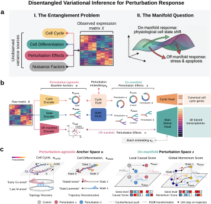

# PertVI: Disentangled Variational Inference for Perturbation Response



## Introduction

In dynamic, multi-condition single-cell perturbation screens, chemical or genetic interventions simultaneously alter cell-cycle and developmental state occupancy, remodel state-dependent gene programs, and trigger acute cellular stress across donors or batches. Conventional monolithic models compress these covarying signals into a single closed-world latent space, where proliferative oscillations fracture state trajectories and compositional shifts become entangled with transcriptional remodeling and cytotoxicity. **PertVI** is a deep generative model built on PyTorch and `scvi-tools` that resolves this variance entanglement through a biology-informed, multi-manifold architecture.

Specifically, PertVI uses three latent encoders operating without perturbation or batch labels to factorize each cell's transcriptome into a low-dimensional cell-cycle anchor (`u_cycle`) that recovers continuous mitotic progression, a baseline cellular state manifold (`u_state`), and an out-of-distribution anomaly subspace (`v_ood`). Perturbation identity enters only after encoding through Split Feature-wise Linear Modulation (Split-FiLM), which applies condition-specific affine transformations to `u_cycle` and `u_state` to form `z_cycle` and `z_state`. The `v_ood` subspace bypasses Split-FiLM entirely, with control cells anchored near its origin so treated cells can route nonlinear stress and toxicity off-manifold. Instead of adversarial discriminators that force the basal state to be completely perturbation-unaware, PertVI achieves disentanglement through perturbation-blind encoding, gene-masked bifurcated decoding, cross-covariance regularization, and post-encoding affine modulation. This allows the basal `u` spaces (`u_cycle` and `u_state`) to preserve genuine on-manifold compositional shifts while remaining perturbation-agnostic. From a single trained model, PertVI supports deconfounded proliferation and state-occupancy profiling on `u_cycle` and `u_state`, counterfactual expression and trajectory momentum inference in `z_state`, and off-manifold toxicity screening in `v_ood`.

## Installation

Install `pertvi` from source in Python >= 3.9 (requires `torch>=2.0`, `scvi-tools>=1.0`, `scanpy`, `numpy`, and `pandas`):

```bash
git clone https://github.com/lenore-yue/PertVI.git
cd PertVI
pip install -e .
```

## Quickstart

PertVI takes raw UMI counts, a boolean mask of canonical S and G2/M cell-cycle marker genes in `adata.var["is_cycle_gene"]` (retained alongside highly variable genes), and a float treatment indicator in `adata.obs["is_treated"]` (`0.0` for unperturbed controls, `1.0` for perturbed cells).

```python
import numpy as np
import scanpy as sc
from pertvi import PertVI

adata = sc.read_h5ad("perturbation_screen.h5ad")

# 1. Flag canonical cell-cycle marker genes (required before initializing PertVI)
cycle_genes = ["PCNA", "TYMS", "MCM6", "TOP2A", "CCNB1", "MKI67"]  # e.g., Tirosh et al. S + G2/M set
adata.var["is_cycle_gene"] = adata.var_names.isin(cycle_genes)

# 2. Define float treatment mask: 0.0 for controls, 1.0 for perturbed cells
adata.obs["is_treated"] = np.where(
    adata.obs["perturbation"] == "NTC", 0.0, 1.0
).astype(np.float32)

# 3. Register AnnData fields
PertVI.setup_anndata(
    adata,
    layer="counts",
    batch_key="donor",
    sample_key="perturbation",
    treatment_mask_key="is_treated",
)

# 4. Initialize and train model
model = PertVI(
    adata,
    n_latent_cycle=3,
    n_latent_state=30,
    n_latent_ood=10,
    cycle_gene_mask_key="is_cycle_gene",
)
model.train(
    max_epochs=400,
    warmup_epochs=50,
    anneal_epochs=100,
    batch_size=256,
    early_stopping=True,
)

# 5. Extract disentangled latent representations
# Dict keys: "u_cycle", "u_state", "v_ood", "z_cycle", "z_state", "z_shift", "z_base", "z_final"
latents = model.get_latent_representation()
adata.obsm["X_u_cycle"] = latents["u_cycle"]
adata.obsm["X_u_state"] = latents["u_state"]
adata.obsm["X_v_ood"] = latents["v_ood"]
adata.obsm["X_z_cycle"] = latents["z_cycle"]
adata.obsm["X_z_state"] = latents["z_state"]

model.save("pertvi_model/", overwrite=True)
```

## Downstream

From the learned baseline manifolds (`X_u_state`, `X_v_ood`), `pertvi` computes condition-matched latent displacement (`compute_elsd`), Coupled- and State-Counterfactual Causal Scores (`compute_ccs`), path-integrated perturbation momentum (`compute_momentum_score`), and batch-harmonized or counterfactual expression profiles (`model.get_normalized_expression`). Off-manifold displacement ($d_{\mathrm{ood}}$) is the Euclidean distance from each perturbation centroid to the control centroid in `X_v_ood`.

```python
import numpy as np
import pertvi

# 1. Empirical latent state displacement and inter-perturbation alignment
elsd = pertvi.compute_elsd(
    adata,
    condition_key="condition",
    pert_key="perturbation",
    control_group="NTC",
    latent_key="X_u_state",
)
alignment = pertvi.compute_pairwise_alignment(elsd, metric="cosine")

# 2. Gene- and pathway-level Counterfactual Causal Scores (CCS)
ccs_gene = pertvi.compute_ccs(
    adata,
    model,
    condition_key="condition",
    pert_key="perturbation",
    control_group="NTC",
    latent_key="X_u_state",
    inject_film=True,  # Coupled-CCS (default); set False for State-CCS
)

pathway_dict = {"TCR_Signaling": ["CD3D", "ZAP70", "LAT"]}
ncg_list = ["NCG_1", "NCG_2"]
ccs_pathway = pertvi.compute_ccs(
    adata,
    model,
    condition_key="condition",
    pert_key="perturbation",
    control_group="NTC",
    pathway_dict=pathway_dict,
    calibrate_ncg=True,
    ncg_list=ncg_list,
)

# 3. Path-integrated perturbation momentum along a basal state trajectory
momentum = pertvi.compute_momentum_score(
    adata,
    model,
    style="trajectory-waypoint",  # or "linear", "trajectory-basic"
    pert_key="perturbation",
    control_group="NTC",
    condition_key="condition",
    start_state="Rest",
    end_state="Stim48hr",
    dpt_key="dpt_pseudotime",
    return_decomposition=True,    # returns {"gene": df, "tiv": df, "ld": df}
)

# 4. Counterfactual expression decoding and off-manifold displacement (d_ood)
ntc_adata = adata[adata.obs["perturbation"] == "NTC"].copy()
cf_expr = model.get_normalized_expression(
    adata=ntc_adata,
    transform_sample="Pert_A",
    transform_batch="Donor_1",
)

ctrl_ood = adata.obsm["X_v_ood"][adata.obs["perturbation"] == "NTC"].mean(axis=0)
d_ood = {
    p: float(np.linalg.norm(adata.obsm["X_v_ood"][adata.obs["perturbation"] == p].mean(axis=0) - ctrl_ood))
    for p in adata.obs["perturbation"].unique()
    if p != "NTC"
}
```

## Citation

Wang, Y., Zhao, Y., Li, S. & Yang, D. Disentangled generative modeling of single-cell perturbation responses across dynamic cellular states. *bioRxiv* (2026). [https://www.biorxiv.org/content/10.64898/2026.11.07.765083v1](https://www.biorxiv.org/content/10.64898/2026.11.07.765083v1)

```bibtex
@article{wang2026pertvi,
  title   = {Disentangled generative modeling of single-cell perturbation responses across dynamic cellular states},
  author  = {Wang, Yue and Zhao, Yueshan and Li, Sihan and Yang, Da},
  journal = {bioRxiv},
  year    = {2026},
  doi     = {10.64898/2026.11.07.765083},
  url     = {https://www.biorxiv.org/content/10.64898/2026.11.07.765083v1}
}
```
